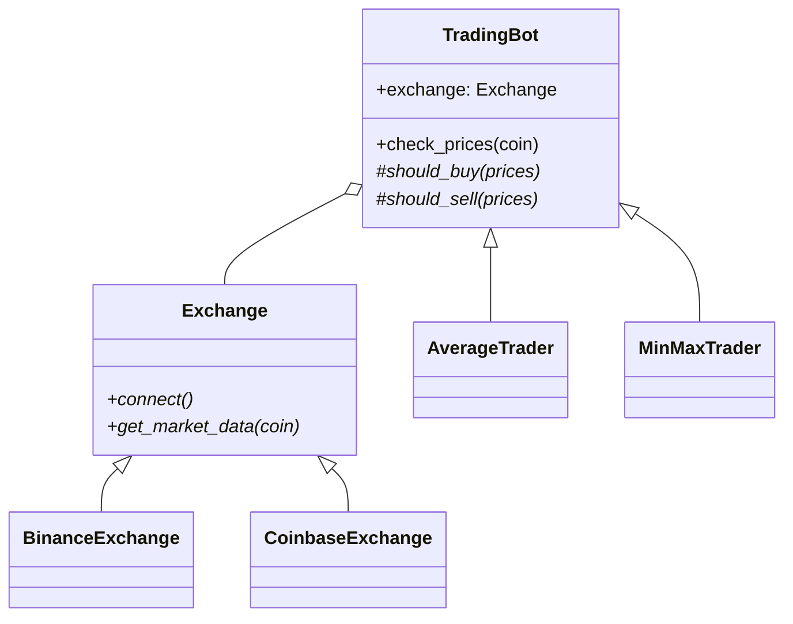

# Behavioral patterns

How objects select algorithms, communicate, and manage state over time.

Contents: [Strategy](#strategy) · [Policy](#policy) · [Template Method](#template-method) · [Observer](#observer) · [Command](#command) · [State machine](#state-machine) · [Specification](#specification) · [Chain of Responsibility and Pipeline](#chain-of-responsibility-and-pipeline)

Runnable, tested versions of Strategy, the state machine, and Chain vs Pipeline are in `examples/` (`strategy_ladder.py`, `state_machine.py`, `pipeline_vs_chain.py`).

---

## Strategy

**Buys:** swapping one algorithm for another without the caller changing.
**Costs:** one level of indirection; the choice is no longer visible where the work happens.

### The Python ladder

Start with a type alias and functions. Climb only when forced.

```python
from typing import Callable
from dataclasses import dataclass

Ordering = Callable[[list[Ticket]], list[Ticket]]

def fifo(tickets: list[Ticket]) -> list[Ticket]:
    return list(tickets)

def filo(tickets: list[Ticket]) -> list[Ticket]:
    return list(reversed(tickets))

def process(tickets: list[Ticket], ordering: Ordering) -> None:
    for ticket in ordering(tickets):
        handle(ticket)
```

An ABC instance, a Protocol instance, an object with `__call__`, and a plain function all satisfy `Ordering` interchangeably. That interchangeability is the point: you can start with functions and introduce a class for one variant later without touching the caller.

### When the strategy needs configuration

This is where Strategy is most often broken. Two tempting approaches that undo the decoupling:

- **`**kwargs` on the strategy method.** The caller must now know which keyword arguments each strategy accepts. You also lose type information: `window_size` wants `int`, `min_price` wants `float` or `Decimal`, and a single `**kwargs` can't express that. (Since Python 3.12, PEP 692's `Unpack[SomeTypedDict]` can type `**kwargs`, but that only moves the problem: the caller still has to know which TypedDict each strategy wants.)
- **A shared `Parameters` dataclass.** Every strategy now depends on one object holding every strategy's settings. It grows monotonically and couples unrelated strategies to each other.

Both fail for the same underlying reason: the calling code ends up knowing implementation details of specific strategies. That is exactly the coupling Strategy exists to remove.

**Put the parameters in the strategy's own constructor.** The only code that knows about `min_price` is the code that already had to know: the composition root.

```python
@dataclass
class MinMaxTrading:
    min_price: float = 30_000.0
    max_price: float = 35_000.0

    def should_buy(self, prices: list[float]) -> bool:
        return prices[-1] < self.min_price

    def should_sell(self, prices: list[float]) -> bool:
        return prices[-1] > self.max_price

# composition root: the one place with concrete knowledge
strategy = MinMaxTrading(min_price=31_000, max_price=34_000)
```

If you prefer functions, a closure is the same thing more concisely:

```python
def random_ordering(seed: int | None = None) -> Ordering:
    rng = random.Random(seed)          # captured; per-strategy, not global
    def order(tickets: list[Ticket]) -> list[Ticket]:
        return rng.sample(tickets, len(tickets))
    return order
```

Prefer a local `random.Random(seed)` over `random.seed(seed)`: the latter mutates global state, which is a coupling bug hiding inside a decoupling pattern.

**A class is the right answer when the strategy has both data and behavior.** Combining state with behavior is what classes are for; treating that as un-Pythonic leads to awkward closures. Equally, if you cannot set the parameters in the constructor and find yourself adding setters, treat that as a signal that the decomposition is wrong rather than as a mechanical problem to solve.

### Failure modes
- Passing settings through the caller (above): the most common one.
- A strategy that needs two methods (`should_buy` / `should_sell`) is not strictly a single-method Strategy. Splitting it into two hierarchies to satisfy the textbook usually adds complication without benefit. Keep it as one object.
- The functional version does not really enforce a contract: anything callable passes. That is a real cost of the type-alias approach; a Protocol gives static checkers more to work with.
- Order of operations: if a strategy can *remove* items, apply it before you check for an empty result.

---

## Policy

**Buys:** rules that can be enabled, disabled, reordered, and tested individually.
**Costs:** ordering becomes implicit and must be documented.

Distinct from Strategy in intent: Strategy picks one, Policy composes many. Structurally they use the same language features.

```python
from dataclasses import replace
from functools import reduce
from typing import Callable

PolicyFn = Callable[[User, Request], Request]

def apply_policies(user: User, request: Request, policies: list[PolicyFn]) -> Request:
    return reduce(lambda req, policy: policy(user, req), policies, request)

def active_user(user: User, req: Request) -> Request:
    if not user.is_active:
        raise PermissionError("user is not active")
    return req

def audit(user: User, req: Request) -> Request:
    return replace(req, audit_log=[*req.audit_log, f"checked {user.name}"])
```

Each policy returns a (usually new) request, so the pipeline threads state without mutation. `dataclasses.replace` keeps the request immutable, which makes each policy independently testable.

### Configurable enablement

A registry plus settings turns the policy list into configuration:

```python
POLICY_REGISTRY: dict[str, PolicyFn] = {
    "active_user": active_user,
    "mfa": mfa_required,
    "audit": audit,
}

class Settings(BaseSettings):
    enabled_policies: list[str] = ["active_user", "audit"]
    model_config = SettingsConfigDict(env_file=".env")

active = [POLICY_REGISTRY[name] for name in Settings().enabled_policies]
```

This is a genuine benefit (turning a rule off becomes a config change rather than a deploy) but it makes the ordering a runtime concern. If some policies *must* precede others (authenticate before authorize; validate before audit), express that explicitly: sort by a declared priority, or validate the configured order at startup and fail fast. Relying on the order someone typed into `.env` is a latent incident.

### Failure modes
- Silent order dependence.
- A policy that both mutates and vetoes, so the caller cannot tell whether a returned request was modified.
- Policies reaching for data they weren't given, via globals or a service locator, which re-introduces the coupling.

---

## Template Method

**Buys:** one fixed process, variable steps, without a separate abstraction per step.
**Costs:** inheritance. Subclasses are coupled to the base class's decomposition of the process.

```python
from abc import ABC, abstractmethod

class TradingBot(ABC):
    def __init__(self, exchange: Exchange):
        self.exchange = exchange

    def check_prices(self, coin: str) -> None:   # the template method
        self.exchange.connect()
        prices = self.exchange.get_market_data(coin)
        if self.should_buy(prices):
            self.exchange.buy(coin)
        elif self.should_sell(prices):
            self.exchange.sell(coin)

    @abstractmethod
    def should_buy(self, prices: list[float]) -> bool: ...
    @abstractmethod
    def should_sell(self, prices: list[float]) -> bool: ...
```

**Where it fits.** Processes that are structurally identical but differ in a step or two: a web shop order flow where digital goods are emailed and physical goods are shipped; support ticket handling where some tickets need an on-site visit and others need a phone call. The process is the same; one step differs.

**Pair it with Bridge.** In the example above, `TradingBot` depends on `Exchange`. Making `Exchange` an abstraction the bot holds at the abstract level lets trading strategies and exchange integrations vary independently. This combination (Template Method for the process, Bridge for the dependency) is one of the most useful in practice, and it works because the two axes are genuinely orthogonal.



### Failure modes
- Subclasses that override the template method itself: the skeleton was the whole point.
- Growing the number of abstract hooks until the base class is an interface with a loop in it. At that point Strategy composition is clearer.
- Deep hierarchies. Two levels is usually the limit before the effective behavior of a leaf class becomes hard to determine by reading.

---

## Observer

**Buys:** adding and removing side effects without touching the code that triggers them.
**Costs:** the end-to-end flow exists in no single file.

```python
# events.py
from collections.abc import Callable
from typing import Any

_subscribers: dict[str, list[Callable[[Any], None]]] = {}

def subscribe(event_type: str, fn: Callable[[Any], None]) -> None:
    _subscribers.setdefault(event_type, []).append(fn)

def post_event(event_type: str, data: Any) -> None:
    for fn in _subscribers.get(event_type, []):
        fn(data)
```

```python
# users.py: lean, imports nothing about Slack or email
def register_new_user(name: str, password: str, email: str) -> None:
    user = db.create_user(name, password, email)
    post_event("user_registered", user)
```

Disabling Slack notifications becomes: don't call Slack's `setup_event_handlers()`. No other file changes.

### Failure modes worth stating explicitly
- **Import order is load-bearing.** A listener module that is never imported is never subscribed, and the failure is silent. Register handlers explicitly at startup from the composition root rather than relying on import side effects.
- **Order-by-subscription.** If listeners must run in a particular order, Observer is the wrong pattern: you want a pipeline or an ordered chain. Making it explicit beats relying on registration order.
- **Event names as strings.** Typos fail silently. Use module-level constants or an `Enum`.
- **The flow disappears.** Fowler: *"it's very easy to make nicely decoupled systems with event notification, without realizing that you're losing sight of that larger-scale flow, and thus set yourself up for trouble in future years."* ([source](https://martinfowler.com/articles/201701-event-driven.html); cosmicpython ch. 11 quotes the same article.) Mitigate with a documented event catalog and correlation IDs in logs.
- **Synchronous handlers hide latency.** If `post_event` runs handlers inline, `register_new_user` doesn't return until the email is sent. That is often surprising to the caller. Decide deliberately: inline (simple, slow, failures propagate) or queued (fast, needs delivery guarantees).
- **Failure semantics.** What happens when one handler raises? Silently swallowing hides bugs; propagating means an analytics failure breaks user registration. Pick one, document it, and log the other.

When side effects must be atomic with the state change, an in-process observer is not enough: see **Transactional Outbox** in `architectural.md`.

---

## Command

**Buys:** operations become values that can be queued, schedulable, batchable, undoable, auditable.
**Costs:** every operation becomes an object.

```python
from dataclasses import dataclass, field
from typing import Protocol

class Transaction(Protocol):
    def execute(self) -> None: ...
    def undo(self) -> None: ...

@dataclass
class Transfer:
    from_account: Account
    to_account: Account
    amount_cents: int

    def execute(self) -> None:
        self.from_account.withdraw(self.amount_cents)
        self.to_account.deposit(self.amount_cents)

    def undo(self) -> None:
        self.to_account.withdraw(self.amount_cents)
        self.from_account.deposit(self.amount_cents)
```

A `Batch` that holds a list of commands and is itself a command gives you composable rollback, and batches can contain batches. Because commands are plain data plus a method, they can also be scheduled: prepare a batch now, execute it tonight when the servers are idle.

Use integer cents, never floats, for money.

### State as ground truth vs transactions as ground truth

This is the more important decision, and the one usually made by default rather than deliberately.

**State-based:** the balance is the truth; each command mutates it and knows how to reverse itself. Easy to read the current value. Hard to answer "how did it get here", and if you keep both a balance and a history you now have two sources of truth that can disagree.

**Transaction-based:** the ledger is the truth; the balance is a computed cache. Undo and redo become pointer movements, no per-command undo logic at all:

```python
@dataclass
class BankController:
    ledger: list[Transaction] = field(default_factory=list)
    current: int = 0

    def register(self, t: Transaction) -> None:
        del self.ledger[self.current:]      # a new action discards the redo future
        self.ledger.append(t)
        self.current += 1

    def undo(self) -> None:
        self.current = max(0, self.current - 1)

    def redo(self) -> None:
        self.current = min(len(self.ledger), self.current + 1)

    def compute_balances(self) -> None:
        bank.clear_cache()
        for t in self.ledger[:self.current]:
            t.execute()
```

Note what disappears: `undo()` on every command class, and the rollback logic inside `Batch`. Error handling moves out to the controller, where it belongs.

**Making replay affordable**: the obvious objection is that replaying the whole ledger gets slower forever. Three real techniques, in increasing order of effort:
1. Track which transactions affect which entities, and invalidate only the affected caches.
2. Recompute caches in the background on a schedule so reads are usually warm.
3. **Checkpoint.** Periodically compute a balance and store it as an `initialize_balance` transaction; replay starts there. Banks do exactly this: you do not replay from the customer's date of birth.

**Choose transactions as ground truth when:** audit history matters, undo/redo is a product feature, you need to replay state, or operations should be deferred rather than applied immediately. Real examples: non-destructive video editing, 3D animation pipelines where transformations are applied to a source recording, accounting ledgers.

The general habit worth forming: we default to state as the ground truth. Ask what the design would look like if transactions were.

### Failure modes
- **Undo that can fail.** What do you do when the undo raises? You would have to undo the undo. There is often no correct automated answer; for money, escalate to a human. Design for it explicitly rather than assuming undo always succeeds.
- **Fat commands.** A command holding a database session instead of the data it needs cannot be serialized, queued, or replayed.
- `redo` written as an alias for `execute`: usually right, occasionally not, because something may have changed since. Keep it a separate method so you have somewhere to put the difference.

---

## State machine

**Buys:** every legal transition visible in one place; illegal transitions fail loudly.
**Costs:** indirection between an event and its effect.

Prefer a data-driven table over a class-per-state hierarchy. The table shows the whole machine at a glance; the hierarchy scatters it across files, and adding one state/event pair means a new class.

```python
from dataclasses import dataclass, field
from enum import Enum, auto
from typing import Callable, Generic, TypeVar

S = TypeVar("S"); E = TypeVar("E"); C = TypeVar("C")
Action = Callable[[C], None]

@dataclass
class StateMachine(Generic[S, E, C]):
    transitions: dict[tuple[S, E], tuple[S, Action]] = field(default_factory=dict)

    def add(self, from_state: S, event: E, to_state: S, action: Action) -> None:
        self.transitions[(from_state, event)] = (to_state, action)

    def handle(self, context: C, state: S, event: E) -> S:
        try:
            new_state, action = self.transitions[(state, event)]
        except KeyError:
            raise ValueError(f"no transition from {state!r} on {event!r}") from None
        action(context)
        return new_state
```

A decorator *method* on `StateMachine` makes the definition declarative and keeps the action next to the transition it belongs to:

```python
class StateMachine(Generic[S, E, C]):          # continued from above
    def transition(self, from_state, event, to_state):
        def decorator(fn: Action) -> Action:
            states = from_state if isinstance(from_state, (list, tuple)) else (from_state,)
            for s in states:
                self.add(s, event, to_state, fn)
            return fn
        return decorator

@machine.transition([State.IDLE, State.PAUSED], Event.START, State.RUNNING)
def on_start(ctx: Session) -> None:
    ctx.start_timer()
```

Accepting a list of source states removes the most common duplication. `examples/state_machine.py` is a typed, tested version on an order lifecycle that also refuses duplicate transitions.

### Failure modes
- Actions with side effects that fail *after* the state has been recorded, or vice versa. Decide whether the action runs before or after the state change, and make it consistent.
- Storing the state on the context and also returning it: pick one owner.
- Machines that grow guard conditions inside actions. Once transitions depend on data, either add a guard to the table explicitly or accept that you have a rules engine, not a state machine.

---

## Specification

**Buys:** business rules that compose with `&`, `|`, `~` and can be assembled at runtime from configuration.
**Costs:** substantial machinery. Easy to over-build.

```python
from typing import Callable, Generic, TypeVar
T = TypeVar("T")

class Predicate(Generic[T]):
    def __init__(self, fn: Callable[[T], bool]) -> None:
        self.fn = fn
    def __call__(self, obj: T) -> bool:
        return self.fn(obj)
    def __and__(self, other: "Predicate[T]") -> "Predicate[T]":
        return Predicate(lambda x: self(x) and other(x))
    def __or__(self, other: "Predicate[T]") -> "Predicate[T]":
        return Predicate(lambda x: self(x) or other(x))
    def __invert__(self) -> "Predicate[T]":
        return Predicate(lambda x: not self(x))
```

With a `@rule` decorator that registers factories by name, rules can be built from a JSON config, which is the only reason this pattern earns its cost.

```python
eligible = min_age(18) & is_active() & ~is_banned()
users = [u for u in all_users if eligible(u)]
```

**Use it only when** rules are genuinely composable, genuinely complex, and genuinely need to change without a deploy. For filtering a list, a comprehension is clearer and every reader already understands it. For most applications the full version is over-engineering, and that is the right default posture.

---

## Chain of Responsibility and Pipeline

Two different patterns that are often given one name. In a **Chain of Responsibility** handlers are tried in order and the *first* one that accepts decides; the rest never run. In a **Pipeline** every stage runs and feeds the next. The trip planner below is a pipeline; earlier versions of this file called it a chain.

```python
Approver = Callable[[Refund], str | None]     # None means "not mine, pass it on"

def decide(r: Refund, chain: list[Approver]) -> str:
    for handler in chain:
        if (verdict := handler(r)) is not None:
            return verdict                    # early exit is the defining property
    raise LookupError("no handler accepted the request")
```

End a chain with a handler that always answers, or raise a named error, so an unmatched request cannot fall off the end. `examples/pipeline_vs_chain.py` has both patterns on orders, and builds the pipeline from generators so stages stream lazily.

### Pipeline with a shared context

**Buys:** an ordered sequence of steps, each filling in part of a shared context, extended by inserting a function.
**Costs:** the shared context object accretes fields.

```python
@dataclass
class TripContext:
    origin: str
    destination: str | None = None
    flight: str | None = None
    hotel: str | None = None

Handler = Callable[[str, Deps, TripContext], None]

def plan_trip(user_input: str, deps: Deps) -> TripContext:
    ctx = TripContext(origin=deps.city)
    chain: list[Handler] = [handle_destination, handle_flight, handle_hotel]
    for handler in chain:
        handler(user_input, deps, ctx)
    return ctx
```

Each handler fills in part of the context using what earlier handlers produced. Adding a step is a function plus a list entry.

This shape is a good fit for multi-step LLM agent pipelines, where each step's output feeds the next and you want to inspect the partial state after a failure. Keep two things in mind there: give each handler a timeout, and make the context serializable so a failed run can be resumed or replayed rather than restarted.

### Failure modes
- The context becoming a god object: see Context Object in `structural.md`.
- Handlers that silently no-op when a precondition is missing, producing an empty result with no explanation. Have them record why they skipped.
- No early exit. If a step determines the request is unanswerable, the pipeline should stop rather than run five more steps against `None`.
