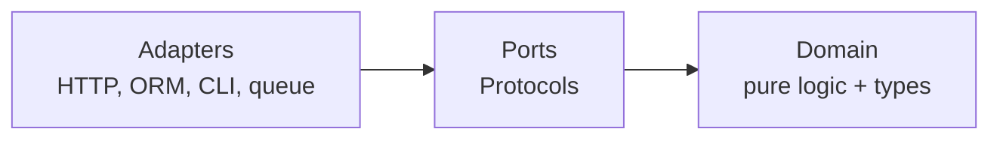

# Selection: picking the right pattern (and knowing when not to)

Contents:
1. [The extension-mechanism ladder](#1-the-extension-mechanism-ladder)
2. [Full symptom index](#2-full-symptom-index)
3. [Confusable patterns, distinguished](#3-confusable-patterns-distinguished)
4. [Cost table: what each pattern charges](#4-cost-table)
5. [Where patterns live in a layered system](#5-where-patterns-live)

---

## 1. The extension-mechanism ladder

Before choosing a *pattern*, choose an *extension mechanism*. Most "which pattern" questions are really this question, and the answer is usually lower on this list than the asker expects.

| Mechanism | Adding a variant means | Choose when | Breaks down when |
|---|---|---|---|
| A new `if` branch | Editing one function | Two or three branches, one team, unlikely to grow | Branches keep arriving, or each branch grows its own state |
| A `dict[str, Callable]` | One function + one dict entry, same file | Variants are simple, all known to one module | Variants need per-variant configuration |
| A dict of dataclasses/classes | One class + one dict entry | Variants carry configuration or several operations | The dict itself becomes a merge-conflict hotspot |
| **Registry** with a `@register` decorator | Dropping in a file; the dict is never edited | Variants live in separate files, plugin-shaped, possibly other teams | Nothing is registered until the module is imported: import order becomes load-bearing |
| **Entry points** (`importlib.metadata`) | Installing a package | Third parties extend you without a fork | Version skew, and debugging "why isn't my plugin loading" |
| **Ports & Adapters** | Implementing a Protocol and wiring it at the composition root | The variation is an entire external dependency | Overkill for anything smaller than a subsystem |

The jump from "dict of functions" to "Registry" is the one most often made too early. A registry's real benefit is that the dispatch table is never edited when a variant is added, which matters when variants live in other files or other repos, and matters not at all when they live in the same 200-line module.

---

## 2. Full symptom index

### Behavior selection

| Symptom | Candidate | Instead of that |
|---|---|---|
| `if/elif` picking one algorithm | **Strategy** | Two branches and stable → leave it |
| Variants added in other files/repos | **Registry** | Same-file variants → plain dict |
| Independent rules that each transform or veto | **Policy** pipeline | One or two checks → inline them |
| Rules that must be composed with and/or/not at runtime | **Specification** | Rules fixed at code time → plain functions; this pattern is easy to over-build |
| `if state == ... and event == ...` | **State machine table** | Fewer than three states → a flag |
| Same skeleton, one or two steps differ | **Template Method** | Steps vary independently → Strategy per step |
| Dispatch on the *type* of an argument, types you own | **`match` + Union + `assert_never`** (exhaustiveness checked by mypy/pyright) | Other modules add types → `functools.singledispatch` |
| Dispatch on the *type* of an argument, open set | **`functools.singledispatch`** | Dispatch on a value → dict; needs two types → not singledispatch, it dispatches on arg 1 only |

### Coupling and side effects

| Symptom | Candidate | Instead of that |
|---|---|---|
| Core operation imports Slack, email, analytics | **Observer / event bus** | One listener, forever → just call it |
| Side effects must be transactional with the write | **Domain Events + Outbox** | Fire-and-forget is fine → in-process observer |
| Domain code imports the web framework or ORM | **Ports & Adapters** | CRUD app with no real domain logic → don't |
| Object constructs its own collaborators | **Dependency Injection** | Truly fixed dependency (stdlib, pure function) → construct it |
| Related objects must be chosen as a consistent set | **Factory** | Arbitrary combinations wanted → DI, not Factory |
| Pure rules tangled with I/O, so tests need mocks | **Functional Core, Imperative Shell** | The decision interleaves many reads and writes → Ports & Adapters |
| `if x is not None` before every use of an optional collaborator | **Null Object** | Absence is an error the caller must handle → raise |

### Boundaries and integration

| Symptom | Candidate | Instead of that |
|---|---|---|
| Third-party interface ≠ your interface | **Adapter** | Signature-only mismatch → `functools.partial` |
| A whole foreign *model* leaking in | **Anti-Corruption Layer** | Models are basically the same → plain adapter |
| Two hierarchies multiplying combinatorially | **Bridge** | Only one axis actually varies → Strategy |
| Many subsystems, one common workflow | **Facade** | Callers need the parts individually → don't hide them |
| Replacing a legacy system | **Strangler Fig** | Small system → rewrite it |
| The same input checks repeated at many call sites; raw dicts passed deep | **Parse, don't validate** + **Value Objects** | Data never crosses a trust boundary → leave it |

### State, history, and scale

| Symptom | Candidate | Instead of that |
|---|---|---|
| Undo/redo needed | **Command** with undo, or a ledger + pointer | Single-level undo → snapshot |
| "How did it get this way?" is a recurring question | **Command with ledger** → **Event Sourcing** | Audit log is all you need → regular logging (Fowler's own advice) |
| Reads and writes have irreconcilable shapes | **CQRS**, scoped to one bounded context | Reads are merely slow → index, denormalized column, or a cached query |
| Read model can lag | **Projection** | Read-after-write must be exact → not CQRS |

### Failure at a boundary

| Symptom | Candidate | Instead of that |
|---|---|---|
| Transient errors from a dependency | **Retry with full jitter**, bounded by attempts, deadline and a per-client retry budget | Throttling (429/503) → still retry, but slower: longer base delay, honour the delay hint, spend from the budget; never retry immediately |
| Caller threads pile up on a slow dependency | **Timeout** first, always | none |
| Dependency is down, not flaky | **Circuit Breaker** | Retries already bounded and cheap → breakers add modal behavior that is hard to test |
| One bad dependency starves everything | **Bulkhead** (per-dependency pool/semaphore) | none |
| Retries could double-charge | **Idempotency key** | none |
| Duplicate messages from at-least-once delivery | **Idempotent Consumer** | Operation is naturally idempotent (upsert, absolute set) → nothing to do |
| p99 dominated by occasional slow replicas | **Hedged requests** at about p95 (about 5% extra load) | Writes or non-idempotent calls → never hedge |

---

## 3. Confusable patterns, distinguished

### Strategy vs Policy
Structurally identical; different in intent, and the intent changes the API you design.
- **Strategy** selects *one* algorithm from alternatives. `sort(strategy=quicksort)`. The alternatives are mutually exclusive.
- **Policy** *composes* many rules that all apply. `apply_policies(user, request, [active_user, mfa, rate_limit])`. Order can matter; each policy receives the output of the previous one.

If you find yourself writing `strategies: list[Strategy]` and running all of them, you have a Policy, and you should design for composition (an ordered list, a `reduce`, an enable/disable switch) rather than selection.

### Strategy vs Template Method
- **Strategy** is composition: the varying behavior is passed in and can change at runtime.
- **Template Method** is inheritance: the fixed process lives in a base class, variable steps are overridden by subclasses. Chosen at class-definition time.

Template Method fits when the variation is *a step or two inside an otherwise fixed process* and a Strategy per step would mean a separate abstraction per step: real boilerplate. Its cost is inheritance: subclasses are coupled to the base's step decomposition, and changing the skeleton breaks every subclass.

They combine cleanly. A common and correct shape: Template Method for the process, plus **Bridge** for the external dependency the process talks to.

### Strategy vs Registry
Orthogonal, frequently confused because both replace `if/elif`.
- **Strategy** is about the *contract*: the caller depends on an interface rather than a concrete implementation.
- **Registry** is about *discovery*: how implementations get found without the core module importing them.

A registry of strategies is a normal, good design. But a registry whose entries are one-line functions no one outside the module writes is just a dict with extra ceremony.

### Factory vs Dependency Injection
- **Factory** when the objects belong together as a *preset*: "master quality" means a specific video codec plus a specific audio codec plus specific settings, and mixing them wrongly is a bug. The factory names a valid combination.
- **DI** when any combination is legitimate and the caller should choose.

The tell: if you would need a factory class per combination, you wanted DI. Note also that a factory does not own what it creates: the caller does; say so in the docstring when lifetime matters.

### Adapter vs Bridge vs Facade vs ACL
- **Adapter**. Retrofit: make an existing incompatible thing fit an interface you already have. Applied after the fact.
- **Bridge**. Designed up front: two hierarchies that both vary, coupled at the abstract level so neither constrains the other.
- **Facade**. Simplify: one entry point over a complicated subsystem. No interface conversion; just a smaller surface.
- **Anti-Corruption Layer**. Defend: a translation region between two *models* with different semantics, so the foreign model cannot infect yours. Bigger than an adapter; keep business rules out of it, and decide up front whether it is permanent or retires with the migration.

### Command vs Event Sourcing vs CQRS
Three scales of the same idea:
- **Command**: one operation captured as an object. Enables queueing, scheduling, batching, undo.
- **Event Sourcing**: the log of all such operations *is* the state. Current state is computed by replay.
- **CQRS**: the read model is separated from the write model, typically a projection of that log.

They escalate in cost in that order. You can adopt Command alone; that is often the right stopping point. CQRS without Event Sourcing is legitimate and cheaper. Event Sourcing without CQRS gets slow reads.

### Observer vs Chain of Responsibility vs Pipeline
- **Observer**: one event, many independent listeners, no ordering guarantee, no shared result. Listeners must not depend on each other.
- **Chain of Responsibility**: ordered handlers, each may handle or pass along; often a shared context object is progressively filled in.
- **Pipeline**: ordered transformations where each output feeds the next input. Deterministic, testable in isolation.

If your "observers" have to fire in a specific order, you have a chain or a pipeline and should model it as one. Order-by-subscription is fragile: it makes import order a semantic dependency.

### Protocol vs ABC vs plain Callable
- **Callable + type alias**: one method, no state. The default.
- **Protocol**: several methods, several implementations, no shared code, and implementations shouldn't have to import your interface.
- **ABC**: you need shared implementation in the base, enforcement at instantiation, `register()` for types you don't own, or an expressed relationship between hierarchies.

See `python-idioms.md` for what `@runtime_checkable` actually verifies (less than you think).

### match vs singledispatch vs dict
- **`match` + Union + `assert_never`**: closed set of types you own; the type checker fails the build when a case is missing.
- **`singledispatch`**: open set; other modules register types; no exhaustiveness.
- **dict of callables**: dispatch on a *value*, not a type.

Details and real checker output: `more-patterns.md`.

---

## 4. Cost table

What each pattern charges, so the trade can be stated honestly.

| Pattern | Buys | Charges |
|---|---|---|
| Strategy | Swap algorithm without touching caller | One indirection; dispatch no longer visible at the call site |
| Policy | Turn rules on/off; test rules alone | Ordering becomes implicit and must be documented |
| Registry | Add variants without editing core | Import-order dependency; harder to see what's registered |
| Template Method | Fixed process, variable steps, low boilerplate | Inheritance coupling; skeleton changes break subclasses |
| Observer | Add/remove side effects freely | End-to-end flow not visible in any single file |
| Command | Undo, queue, schedule, batch, audit | Every operation becomes an object; more code |
| State machine table | All transitions visible in one place | Indirection between event and effect |
| Factory | Valid combinations named and enforced | A class per combination; poor fit for free mixing |
| Builder | Readable stepwise construction | Forgetting `.build()`; two types where one would do |
| DI | Testability; swap at the root | Wiring must live somewhere and be maintained |
| Adapter | Use incompatible code unchanged | One more hop; adapter can drift from the adaptee |
| Bridge | Two axes vary independently | Two hierarchies to understand |
| Ports & Adapters | Domain testable without infrastructure | More files; indirection for simple CRUD |
| Repository / UoW | Storage-agnostic domain; fakeable in tests | Duplicates what the ORM already offers |
| Event Sourcing | Full history; replay; temporal queries | Replay vs external systems; code changes break replay; snapshots needed as the log grows |
| CQRS | Independent read/write scaling and shapes | Two models; eventual consistency |
| Saga | Cross-service consistency without 2PC | No isolation: lost updates and dirty reads must be handled explicitly |
| Circuit Breaker | Fail fast; let a dependency recover | Modal behavior that is hard to test; can extend recovery time |
| Retry | Rides out transient faults | Amplifies load under overload; requires idempotency |
| Retry budget | Bounded retry load in an outage (3,000 → 1,100 attempts in `examples/retry_budget.py`) | Some retries refused; one more piece of per-client state |
| Hedged requests | p99 cut from 212.7 to 26.0 ms in `examples/hedged_request.py` | About 5% extra requests; idempotent reads only |
| Functional Core | Rules testable with plain values, no mocks | Inputs gathered up front; one type per effect |
| Parse, don't validate | Checks in one place, carried by types | A small type per constrained value |
| Null Object | No `None` checks at call sites | Hides absence that should have been an error |

---

## 5. Where patterns live

In a layered or hexagonal system, patterns cluster by layer. If you find one in the wrong layer, that itself is the finding.

- **Inside the domain**: Strategy, Policy, State machine, Command, Specification, Template Method, Composite, Value Object, and the functional core of FC/IS. These see no framework.
- **At the boundary between layers**: Factory, Registry, Builder, Dependency Injection. They decide *which* concrete thing the domain gets.
- **In the adapter layer**: Adapter, Bridge, Anti-Corruption Layer, Repository, and every resilience pattern (retry, breaker, bulkhead, idempotency). Failure policy belongs where the failure originates, not in domain logic.
- **In the composition root**: the wiring. One place, deliberately concrete, kept small.

The invariant that makes this work is the direction of imports: **arrows point inward**. Domain code importing an adapter is the single clearest structural defect you can find by reading imports alone.
