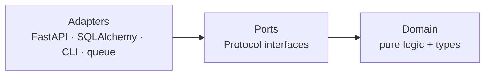

# Structural patterns

How objects and modules compose into larger structures, and where boundaries go.

Contents: [Adapter](#adapter) · [Bridge](#bridge) · [Ports & Adapters](#ports--adapters-hexagonal-architecture) · [Anti-Corruption Layer](#anti-corruption-layer) · [Facade](#facade) · [Decorator](#decorator) · [Composite](#composite) · [Flyweight](#flyweight) · [Context Object](#context-object)

---

## Adapter

Make an incompatible interface (the *adaptee*) satisfy the interface your code expects (the *target*).

### Object adapter: the default

Wrap by composition:

```python
from typing import Any, Protocol

class Config(Protocol):
    def get(self, key: str, default: Any = None) -> Any: ...

class XMLConfig:                       # adapts BeautifulSoup to Config
    def __init__(self, soup: BeautifulSoup) -> None:
        self._soup = soup

    def get(self, key: str, default: Any = None) -> Any:
        element = self._soup.find(key)
        return element.get_text() if element is not None else default
```

A plain `dict` already satisfies `Config`: no adapter needed for the JSON case. That is a useful reminder that structural typing removes a lot of adapter work in Python.

### Class adapter: avoid

Inheriting from the adaptee to adapt it means that when both define the same method name (here, `get`), overriding it changes the meaning of that method for every existing user of the adaptee. You have modified a type you don't own for callers who never asked. Composition has no such effect.

### Functional adapter

When the target is a single callable, `functools.partial` is the whole pattern:

```python
from functools import partial

def get_from_soup(soup: BeautifulSoup, key: str, default: Any = None) -> Any:
    element = soup.find(key)
    return element.get_text() if element is not None else default

config_get = partial(get_from_soup, soup)     # now (key, default=None) -> Any
```

`dict.get`, `XMLConfig().get`, and this partial all satisfy `Callable[[str, Any], Any]`. No class hierarchy at all.

One practical caveat: type checkers handle `partial` imperfectly, so the resulting signature may not be inferred as precisely as you'd like. If the checker's view matters, a small wrapper function with an explicit signature is a reasonable trade.

### Failure modes
- Adapters that acquire business logic. An adapter translates; it does not decide.
- Adapters that swallow the adaptee's errors, so callers can't distinguish "not found" from "the service is down".
- Adapter drift: the adaptee's semantics change and the adapter keeps reporting the old shape. Contract-test it against the real dependency.

---

## Bridge

Two hierarchies that both vary, coupled at the *abstract* level so each can change without touching the other.

The symptom that calls for it is combinatorial: `FastPdfExporter`, `SlowPdfExporter`, `FastHtmlExporter`, `SlowHtmlExporter`. Two axes fused into one hierarchy multiply; separated, they add.

```python
from abc import ABC, abstractmethod
from dataclasses import dataclass
from typing import Protocol

class StreamingDevice(Protocol):
    def get_buffer_data(self) -> bytes: ...

class StreamingService(ABC):
    @abstractmethod
    def start_stream(self) -> None: ...
    @abstractmethod
    def fill_stream(self) -> None: ...

@dataclass
class YouTubeStream(StreamingService):
    device: StreamingDevice          # holds the OTHER hierarchy abstractly

    def start_stream(self) -> None: ...
    def fill_stream(self) -> None:
        data = self.device.get_buffer_data()
        ...
```

Adding `TwitchStream` touches no device. Adding `IPCamera` touches no service.

**The GoF vocabulary is unhelpful here.** The book calls one side "abstraction" and the other "implementation", but both sides are abstract, and which is which is arbitrary. Say "two hierarchies with a dependency between them at the abstract level": that is the actual mechanism.

**Bridge is the strongest case for an ABC over a Protocol** when the base holds *state*. Here every service shares a device list, which is a field, and a field needs a real base class:

```python
@dataclass
class StreamingService(ABC):
    devices: list[StreamingDevice] = field(default_factory=list)

    def add_device(self, device: StreamingDevice) -> None:
        self.devices.append(device)

    def retrieve_buffer_data(self) -> list[bytes]:
        return [d.get_buffer_data() for d in self.devices]

    @abstractmethod
    def start_stream(self) -> None: ...
```

A Protocol can share *methods*: explicit subclasses inherit its default bodies (`scripts/verify_python_claims.py`, check P3). It cannot share the `devices` field, because a Protocol's annotated attributes are interface members, not storage. If the shared part is only methods, an explicitly subclassed Protocol works, and outside implementations still satisfy it structurally.

**Functional variation.** If the implementation side has exactly one method, replace the hierarchy with a callable type alias:

```python
BufferFn = Callable[[], bytes]

@dataclass
class YouTubeStream:
    buffer: BufferFn
    def fill_stream(self) -> None:
        data = self.buffer()
```

The decoupling now comes from the *type*, which is a good general lesson: types are a decoupling mechanism, not just a checking mechanism.

---

## Ports & Adapters (Hexagonal Architecture)

Three regions: pure domain in the middle, ports (interfaces the domain needs) around it, adapters (implementations) outside. **Nothing in the domain imports a framework.**

Cockburn's stated intent: *"Allow an application to equally be driven by users, programs, automated test or batch scripts, and to be developed and tested in isolation from its eventual run-time devices and databases."* His one rule: *"code pertaining to the inside part should not leak into the outside part."*



**Domain**: dataclasses, enums, pure functions, domain exceptions. No framework imports.

```python
@dataclass(frozen=True)
class OrderRequest:
    sku: str
    quantity: int

class OutOfStock(Exception):
    def __init__(self, sku: str, available: int, requested: int) -> None:
        super().__init__(f"{sku}: {available} available, {requested} requested")
        self.sku, self.available, self.requested = sku, available, requested
```

**Port**: what the domain needs, expressed in domain terms:

```python
class InventoryPort(Protocol):
    def exists(self, sku: str) -> bool: ...
    def get_stock(self, sku: str) -> int: ...
    def reserve(self, sku: str, quantity: int) -> int: ...
```

**Use case**: pure logic, testable with a dict-backed fake:

```python
def place_order(request: OrderRequest, inventory: InventoryPort) -> OrderPlaced:
    if not inventory.exists(request.sku):
        raise UnknownSKU(request.sku)
    available = inventory.get_stock(request.sku)
    if available < request.quantity:
        raise OutOfStock(request.sku, available, request.quantity)
    remaining = inventory.reserve(request.sku, request.quantity)
    return OrderPlaced(request.sku, request.quantity, remaining)
```

**Adapter**. Translation only: parse input, call the domain, map errors to transport:

```python
@router.post("/orders")
def create_order(body: OrderRequestDTO, db: Session = Depends(get_db)) -> OrderResponseDTO:
    try:
        result = place_order(OrderRequest(body.sku, body.quantity),
                             SQLAlchemyInventory(db))
    except UnknownSKU as e:
        raise HTTPException(404, f"Unknown SKU: {e.sku}")
    except OutOfStock as e:
        raise HTTPException(409, str(e))
    return OrderResponseDTO(sku=result.sku, remaining_stock=result.remaining_stock)
```

### Practical notes
- **The layering relapse.** Cockburn's own warning: organizations add a layer and find *"a few years later that the new layer is cluttered with business logic and the old problem has reappeared."* A layer without an enforced import direction buys nothing. Enforce it rather than trusting discipline: `scripts/check_layers.py` checks direct imports with the stdlib, and `examples/ports_adapters/pyproject.toml` holds a working import-linter `forbidden` contract (run `PYTHONPATH=. lint-imports` from that folder) that also catches transitive chains. Injecting `import sqlite3` into the example's domain package fails both.
- **The hexagon shape means nothing.** Six sides were chosen for drawing room. There is no correct number of ports; a port per use case is too many, two ports for everything is too few, and *"neither extreme appears optimal."*
- **Primary vs secondary actors.** Primary actors drive the application (HTTP, CLI, tests); secondary actors are driven by it (database, email, payment API). The port shapes differ accordingly.
- **When not to.** Cockburn gives no overkill warning, but the cosmicpython authors do, for the same family of patterns: *"If your app is just a simple CRUD (create-read-update-delete) wrapper around a database, then you don't need a domain model or a repository."* If the "domain logic" is field validation and a save, the layers are ceremony.

> Sources: [Cockburn, Hexagonal Architecture](https://alistair.cockburn.us/hexagonal-architecture/) · [cosmicpython ch. 2](https://www.cosmicpython.com/book/chapter_02_repository.html)

---

## Anti-Corruption Layer

A translation region between two systems with genuinely different *models*, so the foreign model cannot infect yours. Bigger than an adapter: an adapter converts a call, an ACL converts a worldview.

Use it when integrating a legacy system or an external service whose schema, vocabulary, and invariants differ from yours: *"When you maintain access between new and legacy systems, you force the new system to adhere to at least some of the legacy system's APIs or other semantics. When these legacy features have quality problems, this support corrupts what might otherwise be a cleanly designed modern application."*

Costs and constraints, all documented:
- Adds latency and an extra deployable to operate, monitor, scale and release.
- **Keep business rules and orchestration out of it.** Microsoft's guidance: *"Avoid placing business rules or orchestration in the layer."* The ACL translates and nothing else.
- Validate and sanitize at this boundary: the two sides have different trust levels.
- Plan observability: correlation IDs and structured logging, because translation failures are otherwise invisible.
- **Decide its lifecycle up front.** Permanent, or retired when the migration completes? An ACL with no retirement decision becomes permanent by default.
- **Don't build one when the models aren't actually different.** If the shapes basically match, a plain adapter is enough.

> Source: [Azure, Anti-corruption Layer](https://learn.microsoft.com/en-us/azure/architecture/patterns/anti-corruption-layer)

---

## Facade

One simplified entry point over a complicated subsystem. No interface conversion: just a smaller surface for the common case.

Legitimate when a workflow always uses the same five calls in the same order. Illegitimate when callers genuinely need the parts individually and the facade hides them: you have then reduced capability, not complexity. Keep the underlying components public and importable.

The failure mode is the facade that grows a method per caller until it is a god object with a friendlier name.

---

## Decorator

Wrap an object (or function) to add behavior without changing it.

For functions, Python's `@decorator` syntax with `functools.wraps` is the everyday form. For objects, wrapping is composition:

```python
@dataclass
class TimedExporter:
    inner: Exporter

    def export(self, data: str, path: Path) -> None:
        start = time.perf_counter()
        self.inner.export(data, path)
        log.info("export took %.3fs", time.perf_counter() - start)
```

Rhodes' caveat is precise and worth knowing: *"The Decorator Pattern in Python supports programming — but not metaprogramming. Code that is happy to simply access attributes will be happy to accept a Decorator Pattern wrapper instead. But code that indulges in introspection will see the difference."* A wrapper is not the wrapped object: `isinstance` checks, `__name__`, attribute access, and pickling all see the wrapper. `functools.wraps` fixes the metadata for functions; for objects there is no equivalent, and reaching for `__getattr__` forwarding solves attribute access at the cost of making the wrapper opaque to type checkers.

> Source: [Rhodes, Decorator](https://python-patterns.guide/gang-of-four/decorator-pattern/)

---

## Composite

Give container objects and leaf objects the same interface so callers can treat one item and a tree of items identically.

Python does not require a shared base class for this: duck typing suffices, and a Protocol documents the shared surface if you want one. The `Batch` command in `behavioral.md` (a command containing commands) is a composite.

Watch for the interface that only half fits: if `add_child()` has to raise on leaves, the abstraction is leaking. Either split the interface or accept that leaves and containers are different types.

---

## Flyweight

Share immutable instances instead of allocating duplicates.

Python already does this for small integers, interned strings, and `True`/`False`. Beyond Rhodes' list: `Enum` members are canonical instances by construction, which makes `enum` the answer to most "I need a single shared instance" questions.

If you build your own, two requirements: the shared objects must be **immutable** (a mutation by one holder is visible to all), and unbounded caches need `weakref.WeakValueDictionary` or they become a memory leak.

> Source: [Rhodes, Flyweight](https://python-patterns.guide/gang-of-four/flyweight/)

---

## Context Object

Group related parameters into a dataclass and pass that instead of six positional arguments.

```python
@dataclass(frozen=True)
class ReportConfig:
    input_file: Path
    output_file: Path
    start_date: datetime
    end_date: datetime
    metrics: list[MetricFn]

def generate_report(config: ReportConfig, writer: ReportWriter) -> None:
    data = read_data(config.input_file)
    filtered = filter_by_date(data, config.start_date, config.end_date)
    report = {k: v for m in config.metrics for k, v in m(filtered).items()}
    writer.write(report, config.output_file)
```

**Use at high-level orchestration**, where the parameters genuinely travel together and adding one shouldn't ripple through every call site.

**Don't use at low levels.** A function that needs two values should take two values. Passing a context so a helper can reach into it creates false coupling: the helper now depends on a type it barely uses, and can't be reused elsewhere.

**The god-object failure.** If every function in the codebase takes `Context`, you have re-invented global variables with extra steps. The structural tell: a context whose fields are unrelated to each other, added over time to avoid changing signatures. Each field should have a reason to sit with the others.
