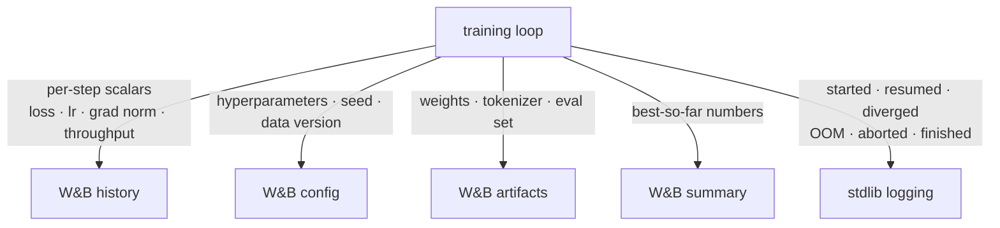

# Instrumenting a training run

Read this when writing or reviewing a training script. `assets/examples/train_example.py`
is the complete working version; this file is the reasoning behind it.

Contents: [What goes where](#what-goes-where) · [What to log, and how often](#what-to-log-and-how-often) ·
[The loop skeleton](#the-loop-skeleton) · [Checkpoints and resumption](#checkpoints-and-resumption) ·
[Failure modes worth instrumenting](#failure-modes-worth-instrumenting) ·
[Reproducibility fields](#reproducibility-fields) · [Cost](#cost)

## What goes where



The test for which side an item belongs on: *is it a number moving over time, or an event
with a cause?* Loss is a number; "resumed from step 4000 after preemption" is an event. A
number in the log is unplottable; an event in W&B history is unsearchable.

The two streams should agree. `obslog.wandb_run.start_run` binds the W&B run id into the
logging context, so every log record from the run carries `wandb_run_id` and a dashboard
run can be matched to a log file without guessing. The binding is a `ContextVar`, so it
reaches asyncio tasks created later but not `DataLoader` worker processes or plain thread
pools (`stdlib-logging.md`, "Context on every record").

## What to log, and how often

| Signal | Where | Frequency | Why it earns its place |
|---|---|---|---|
| `train/loss` | W&B | per step (or per N steps) | The thing you are optimizing |
| `train/lr` | W&B | per step | Schedules misfire silently; a flat or spiking LR explains most weird curves |
| `train/grad_norm` | W&B | per step | The earliest visible sign of divergence, usually hundreds of steps before the loss moves |
| `train/tokens_per_sec` or `samples_per_sec` | W&B | per N steps | Catches a dataloader bottleneck or a thermal throttle that a loss curve hides |
| `train/step_time_ms` | W&B | per N steps | Same, at finer grain; separates compute from data loading |
| `val/*` | W&B | per epoch or per eval interval | With `epoch` as its own x-axis |
| `system/gpu_mem` | W&B | per N steps | W&B logs system metrics itself; log peak allocated when you are tuning batch size |
| Run started / config summary | log, INFO | once | Says what is running and where its dashboard is |
| Resumed from step N | log, INFO | once | The single most useful line when reading a restarted run |
| Eval finished, value | log, INFO | per eval | So the log alone tells the story if W&B is unreachable |
| Checkpoint written / artifact logged | log, INFO | per checkpoint | Ties a file on disk to a run id |
| NaN / inf loss, OOM, dataloader error | log, ERROR with `exc_info` | on occurrence | The traceback is only available now |
| Per-step progress | neither | n/a | A per-step log line at 1000 steps/s is a self-inflicted outage; that is what the loss curve is for |

## The loop skeleton

```python
configure(level="INFO", fmt="console", service="train")   # entry point only
logger = logging.getLogger(__name__)

with start_run(
    project="lm-from-scratch",
    name=f"lr{cfg.lr}-bs{cfg.batch_size}-seed{cfg.seed}",
    config=asdict(cfg),                       # the whole config (WB002)
    job_type="train",
    group=f"ablation-{cfg.ablation}",
    step_metrics={"train/*": "train/step", "val/*": "epoch"},
    summary_goals={"val/loss": "min"},
) as run:
    logger.info("training started: %d epochs, %d steps/epoch", cfg.epochs, steps)
    for epoch in range(start_epoch, cfg.epochs):
        with log_context(epoch=epoch):        # every record below carries epoch
            for batch in loader:
                loss = step(batch)
                run.log({"train/loss": loss, "train/lr": lr,
                         "train/grad_norm": gn, "train/step": global_step})
            val = evaluate()
            run.log({"val/loss": val, "epoch": epoch})
            logger.info("epoch %d: train=%.4f val=%.4f", epoch, train_loss, val)
            if val < best:
                best = val
                save(path)
                log_checkpoint(run, path, metadata={"epoch": epoch, "val_loss": val},
                               aliases=["best"])
    run.summary["best_val_loss"] = best
```

Points that matter more than they look:

- `step_metrics` declares the x-axes once, so `run.log` never takes `step=` (rule WB006).
- `log_context(epoch=epoch)` puts the epoch on every log record without repeating it in
  every message string.
- The checkpoint is logged as an artifact at the moment it becomes best, so `model:best`
  always points at the weights that produced the best number.
- The summary is set explicitly rather than relying on the last logged value.

## Checkpoints and resumption

A long run will be interrupted. Make that a one-line event rather than an investigation:

```python
id_file = out_dir / "wandb_run_id.txt"                          # stable across restarts
if not id_file.exists():
    id_file.write_text(uuid.uuid4().hex[:8])
run_id = id_file.read_text().strip()

with start_run(project=..., config=..., run_id=run_id, resume="allow") as run:
    start_epoch, global_step = 0, 0
    if ckpt_path.exists():                     # the checkpoint decides, not run.resumed
        state = torch.load(ckpt_path)
        start_epoch, global_step = state["epoch"] + 1, state["global_step"]
        logger.info("resumed run %s from epoch %d, step %d (wandb resumed=%s)",
                    run.id, start_epoch, global_step, run.resumed)
```

Branch on the checkpoint, not on `run.resumed`: offline, `run.resumed` is always False
(`verified-behavior.md` section 9), so a resume keyed on it silently restarts training
from epoch 0.

Checkpoint contents that make resumption real: model state, optimizer state, scheduler
state, epoch, global step, RNG states, and the config. A checkpoint missing the optimizer
state restarts Adam's moments from zero, which shows up as a loss bump that looks like a
bug in the model.

In offline mode the restarted process cannot see the earlier history (`run.resumed` is
False, `run.step` is 0), which is why the checkpoint is authoritative. Since wandb 0.31.0
`wandb sync` can still append the offline data to the existing run when it was created
with `resume="must"`.

## Failure modes worth instrumenting

| Failure | How to catch it | What to emit |
|---|---|---|
| Loss goes NaN/inf | `math.isfinite(loss)` check each step | ERROR with step number, `run.summary["diverged_at_step"]`, then abort |
| Gradients exploding | `train/grad_norm` in W&B, clipping counter | The metric is enough; a WARNING when clipping fires on most steps |
| Silent data problem | Log dataset size, first-batch shapes, label distribution at start | INFO once; a wrong dataset is otherwise invisible until the metric is bad |
| Dataloader starvation | `train/step_time_ms` vs a compute-only timer | Metric, plus a WARNING if the gap is persistent |
| OOM | `except torch.cuda.OutOfMemoryError` | ERROR with `exc_info`, batch size and step, then re-raise |
| Preemption | Signal handler for SIGTERM | INFO "preempted at step N, checkpoint written", then exit |
| Eval regression | Compare against `run.summary["best_val_loss"]` | INFO on improvement, so the log shows the trajectory |

A NaN check is worth its cost: the alternative is discovering at hour six that hour two was
wasted.

## Reproducibility fields

Log these in `config` at `init`; each one is a question someone will ask about the run:

- Every hyperparameter, including the ones you did not vary.
- Seed(s), and whether deterministic kernels were enabled.
- Dataset identity: path plus a version or content hash, or a W&B dataset artifact.
- Code identity: `save_code=True`, or the git SHA and dirty flag in the config.
- Environment: framework version, CUDA version, GPU model and count.
- Effective batch size, when it is derived (`per_device * accum * world_size`): the
  derived number is what actually matters and the one people compare wrong.

## Cost

W&B's overhead is a background thread and periodic HTTP; per-step scalar logging is cheap
and its cost is dominated by whatever you compute to produce the value. Two things that do
cost:

- **`.item()` on every step to fetch a loss** forces a GPU sync. Accumulate on-device and
  log every N steps, or accept the sync knowingly.
- **Images, tables, histograms, and `run.watch`** are far heavier than scalars. Per-epoch,
  not per-step.

If no key is configured, or the server is unreachable (`wandb.init` raises `CommError`
after `init_timeout`, 90 s by default), `start_run` falls back to offline mode rather than
failing the job; the run syncs later with `wandb sync`. A training script should never die
because a dashboard was down.
