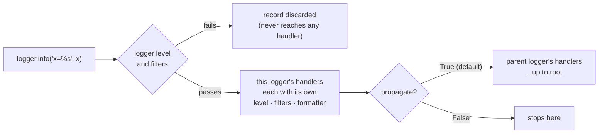

# stdlib logging: the mechanics that decide whether output appears

Read this when configuring logging, or when output is missing, duplicated, or unparseable.
Everything here is stdlib (no dependencies) and was executed on Python 3.11.17, 3.12.13,
3.13.16 and 3.14.6.

Contents: [The pipeline](#the-pipeline) · [Levels](#levels) · [Configuration](#configuration) ·
[Context on every record](#context-on-every-record) · [Structured output](#structured-output) ·
[Keeping I/O off the hot path](#keeping-io-off-the-hot-path) · [Rotation](#rotation) ·
[Multiple processes](#multiple-processes) · [Testing log output](#testing-log-output) ·
[Diagnosing missing or duplicated output](#diagnosing-missing-or-duplicated-output)

## The pipeline

One log call traverses this. Every "why is there no output" question is answered somewhere
along it.



Two asymmetries do most of the damage:

- A **logger** rejecting a record kills it outright: no handler of its own, and no
  parent's handler, ever sees it. A **handler** rejecting a record only skips that
  handler; siblings and ancestors still get it.
- Propagation walks up to the *parent logger's handlers*, and does **not** re-check the
  parent logger's level. `logging.getLogger("app.db")` at DEBUG will reach root's handlers
  even if root is at WARNING; only root's *handler* levels apply.

Real output for the duplicate case, a handler on both a child and root:

```
app.db -> connected
app.db -> connected            # once from the child's handler, once from root's
--- with propagate=False ---
app.db -> connected
--- logger level vetoes handler level ---
app.quiet -> seen              # the INFO line never reached the INFO handler
```

The design that avoids all of it: **handlers only on root, no handlers on module loggers,
propagation left alone.** Then each record is emitted once per destination, and
third-party libraries get the same treatment as your code.

## Levels

| Level | Value | Use for |
|---|---|---|
| DEBUG | 10 | Detail you only want while actively debugging |
| INFO | 20 | Lifecycle events a healthy system produces at readable volume |
| WARNING | 30 | Degraded but working. **The default threshold if nothing is configured** |
| ERROR | 40 | An operation failed |
| CRITICAL | 50 | The process cannot continue |

A logger or handler at INFO passes INFO and above. Two independent gates: set the root
logger to DEBUG and let each handler pick its own cutoff; a root level above a handler's
level silently vetoes that handler, which is a confusing failure to debug.

`logger.setLevel(logging.NOTSET)` (the default for a new logger) means "inherit from the
nearest ancestor with a level set", which is how per-subsystem verbosity works:

```python
logging.getLogger("myapp.db").setLevel(logging.DEBUG)   # just the DB layer
```

## Configuration

`dictConfig` over `basicConfig` for anything with more than one destination. `basicConfig`
hides the handler and formatter objects, is a no-op once root has handlers, and silently
does nothing on its second call unless `force=True`.

`assets/obslog/setup.py` builds the dict; `build_config()` returns it for inspection:

```python
from obslog.setup import build_config
build_config(level="INFO", fmt="json", service="checkout", log_file="app.log")
```

Keys worth knowing:

| Key | Why it is there |
|---|---|
| `version: 1` | The only schema version. Required. |
| `disable_existing_loggers: False` | The default `True` disables every logger created before this call that the config does not name (or name an ancestor of), i.e. every library's. |
| `"ext://sys.stdout"` | `ext://` tells dictConfig to resolve an external Python object instead of using the literal string. |
| `"()"` instead of `"class"` | A factory. Required to pass custom constructor kwargs to your own formatter/filter/handler class; `"class"` only forwards the arguments the stdlib classes accept. |
| `filters: [...]` on a handler | Attaches a filter to *every* record reaching that handler, including third-party records. Filters on a logger only see that logger's records. |
| `loggers: {"urllib3": {"level": "WARNING"}}` | Per-library volume control, with no handlers of their own. |

Console output goes to **stdout**, not the stderr default. Under systemd, Docker, k8s, or
a Jupyter kernel, stdout is the log stream and stderr is where crashes and warnings go;
splitting your own records across both makes ordering unreliable.

## Context on every record

The problem: a line saying "payment failed" is unusable when 200 requests are in flight.
Threading a `request_id` parameter through every function is the naive fix and does not
survive a real call stack.

`contextvars.ContextVar` holds a value per *context*. An asyncio task runs in a copy of
the context that was current when the task was created, so a value set inside one request
is visible to everything that request awaits or spawns, and invisible to concurrent
requests. A `logging.Filter` copies it onto each record:

```python
from obslog.context import log_context

with log_context(request_id="29a6002c26fc", path="/charge"):
    logger.info("request received")     # every record inside carries both fields
```

Real JSON output (`assets/examples/service_example.py`, three concurrent requests):

```json
{"timestamp": "2026-08-26T22:19:34.187+00:00", "level": "INFO", "logger": "__main__", "message": "request received", "module": "service_example", "line": 47, "service": "checkout-api", "version": "1.4.2", "env": "dev", "request_id": "29a6002c26fc", "path": "/charge"}
{"timestamp": "2026-08-26T22:19:34.187+00:00", "level": "DEBUG", "logger": "__main__", "message": "charging 1200 cents", "module": "service_example", "line": 30, "service": "checkout-api", "version": "1.4.2", "env": "dev", "request_id": "29a6002c26fc", "path": "/charge"}
```

The second line comes from a function three frames down that takes no id argument.

Where the context does **not** follow on its own (verified on 3.11 to 3.14, default builds;
full table in `verified-behavior.md` section 13):

- **A new thread or a thread pool.** `threading.Thread`, `ThreadPoolExecutor.submit`, and
  `loop.run_in_executor` start the worker in an empty context, so records from it carry no
  `request_id`. `asyncio.to_thread` *does* copy the context. To carry it into a pool:
  `pool.submit(contextvars.copy_context().run, fn, *args)`, or bind the id again in the
  worker. (On the free-threaded 3.14 build, or with `-X thread_inherit_context=1`, new
  threads inherit a copy of the caller's context.)
- **A task created before the value was bound.** Tasks copy the context at creation, so a
  background task started at startup never sees a later request's id.
- **Another process.** Context is per process; pass the id in the job payload and bind it
  in the worker.

Two related mechanisms, for when a filter is the wrong shape:

- `logging.LoggerAdapter(logger, {"job": "nightly"})` wraps one logger with fixed context.
  Simple, but the context is bound to the adapter object, not to the execution: awkward
  for per-request values.
- `logging.setLogRecordFactory(f)` replaces record construction process-wide. Powerful and
  global; a filter is easier to reason about and easier to remove.

**Where a context filter runs matters.** A filter attached to a handler runs wherever that
handler runs. Behind a `QueueHandler`, the real handlers run in the listener's background
thread, where the ContextVar is empty, so context filters belong on the QueueHandler
itself, in the calling thread. `build_config()` does exactly this; see
`verified-behavior.md` for the output before and after.

## Structured output

`assets/obslog/json_formatter.py` emits JSON Lines: one self-contained JSON object per
line, so the file is parsed line by line (`json.loads` per line), not as one document.

What it does beyond dumping the message:

- `extra={...}` fields and filter-added context become top-level keys, by diffing the
  record against the set of builtin `LogRecord` attributes.
- Exceptions become a nested object (`exception.type`, `exception.message`,
  `exception.traceback`), so a backend can count errors by class instead of regexing a
  blob.
- `static={"service": ..., "version": ..., "env": ...}` is stamped on every record; log
  backends group by these, and setting them once here beats passing them at call sites.
- `json.dumps(..., default=str)` so one unserializable object degrades a field rather than
  raising inside the logging call.

Third-party alternatives, when a project already has one: `python-json-logger` (a
formatter, same shape as this), `structlog` (a whole logging front end built around
key-value context, renders to JSON or console; worth it when structured output is the
primary requirement), `loguru` (opinionated, one global logger, batteries included; trades
stdlib compatibility for convenience). All three still end at stdlib handlers, so none of
the rules in this skill change.

## Keeping I/O off the hot path

Every log call does I/O in the calling thread. A file on a slow disk, or a handler that
writes over the network, blocks the request or training step that made the call.
`QueueHandler` enqueues the record and a background `QueueListener` does the real
dispatch.

Python 3.12+ wires the listener from `dictConfig` when the handler entry carries a
`handlers` list:

```python
"handlers": {
    "queue": {
        "class": "obslog.setup.ContextQueueHandler",
        "handlers": ["stdout", "file"],
        "filters": ["context", "redact"],
        "respect_handler_level": True,
    },
},
"root": {"level": "DEBUG", "handlers": ["queue"]},
```

Three details that are easy to get wrong:

1. **dictConfig builds the listener but does not start it.** Fetch it and start it:
   `logging.getHandlerByName("queue").listener.start()`, and register
   `listener.stop` with `atexit`; otherwise nothing is emitted at all, and records still
   in the queue at shutdown are lost. `configure()` does both, and `ContextQueueHandler`
   also starts its listener on first use, so frameworks that call `dictConfig` themselves
   (Django `LOGGING`, gunicorn `logconfig_dict`) still produce output. Calling `stop()`
   twice raises `AttributeError` on 3.12 (fixed in 3.13); `_stop_once` guards it.
2. **`respect_handler_level` defaults to False**, meaning the listener sends every record
   to every handler regardless of that handler's level. Set it to True unless you want
   DEBUG in the file *and* on the console.
3. **The stock `QueueHandler.prepare()` formats the record and clears `exc_info`.** It
   does that so records can cross a process boundary (tracebacks are not picklable), but
   inside one process it destroys structured exceptions and pre-renders the message with
   the *queue handler's* formatter. `ContextQueueHandler` overrides `prepare()` to enqueue
   the record untouched. Consequence to accept: records are enqueued by reference, so log
   values rather than mutable live objects.

On Python 3.9-3.11 there is no auto-wiring; `obslog.setup.configure_queue_manually([...])`
builds the queue, handler, listener and atexit hook by hand. Same shape, same behavior.

## Rotation

`RotatingFileHandler(filename, maxBytes=10_000_000, backupCount=5)` writes until the file
hits `maxBytes`, renames it to `app.log.1`, and starts a fresh file; past `backupCount`
the oldest is deleted. `TimedRotatingFileHandler(when="midnight", backupCount=14)` rotates
on a schedule instead, which is better when retention is expressed in days.

Neither is safe for multiple processes writing the same file: two processes both deciding
to rotate will interleave and lose records. Under gunicorn/uvicorn with workers, either
log to stdout and let the supervisor handle files, or give each worker its own filename,
or use `SocketHandler` to a single collector process.

In containers, prefer stdout with no file handler at all. The runtime already captures,
rotates, and ships it; a file inside the container is one restart away from gone.

## Multiple processes

Each process has its own logging configuration. A `fork`ed child inherits the parent's
handlers; `spawn` and `forkserver` children start unconfigured. The default start method
on Linux changed from `fork` to `forkserver` in Python 3.14 (verified: on 3.14 a child
started with the default method had no root handlers), so code that relied on inherited
logging config in `multiprocessing` workers or `DataLoader(num_workers>0)` loses its
output there. Configure logging in the worker itself (`Pool(initializer=...)`,
`DataLoader(worker_init_fn=...)`). A forked child also inherits a
queue whose listener thread does *not* survive the fork, so call
`configure(..., force=True)` in the child. File handlers shared across processes
interleave.

The cookbook pattern: each worker gets a `QueueHandler`-only configuration pointing at a
`multiprocessing.Queue`; one listener process owns the real handlers. Here the *stock*
`QueueHandler.prepare()` behavior is correct (the record must be picklable to cross the
boundary), so use `logging.handlers.QueueHandler`, not `ContextQueueHandler`, for a
cross-process queue.

For PyTorch DDP specifically: configure logging on every rank, but let only rank 0 emit
INFO to the console (`level = INFO if rank == 0 else WARNING`), and include the rank in
the format string or as a bound context field. Eight ranks logging identical INFO lines
makes a log eight times longer and no more informative.

## Testing log output

Instrumentation is code whose bugs are invisible unless something asserts on the output.

- **pytest's `caplog`**: `caplog.records` gives the `LogRecord` objects, so assert on
  `record.levelno` and on `extra` fields, not on rendered strings.
  `with caplog.at_level(logging.DEBUG, logger="myapp.db"):` scopes the level.
- **`unittest`'s `assertLogs`**: `with self.assertLogs("myapp", level="INFO") as cm:`.
- **Formatter-level tests**: build a `LogRecord` directly and call `formatter.format(...)`
  on it, then `json.loads` the result, with no global state involved. `assets/tests/test_obslog.py`
  does this.

Assert on the *fields* a downstream query would use. A test asserting on the exact rendered
line breaks when you add a column to the format string, which is not a regression.

## Diagnosing missing or duplicated output

| Symptom | First thing to check |
|---|---|
| Nothing appears at all | Did anything call `configure()`/`dictConfig`? With no configuration, only WARNING+ goes to stderr. |
| INFO missing, WARNING fine | The *logger's* level, then the *handler's*. Both must pass. |
| Every line appears twice | A handler on both a module logger and root, with propagation on. Print `logging.getLogger("x").handlers` and walk up. |
| Third-party logs vanished after adding config | `disable_existing_loggers` defaulted to True. |
| JSON records have the traceback inside `message` | A stock `QueueHandler` pre-formatted the record. |
| Context fields missing only under a queue | The context filter is on the sink instead of the QueueHandler. |
| Output stops after a crash | No `atexit` flush on the queue listener. |
| uvicorn/gunicorn lines bypass your JSON, or print twice | The server installs its own handlers on `uvicorn.*`/`gunicorn.*` loggers with `propagate=False`. See `services.md`. |
| Context fields missing in some records but not others | That code runs in a thread pool or a task created before the bind; see "Context on every record". |
| No output at all on 3.12+ under Django/gunicorn | A stock `QueueHandler` whose listener nobody started. `ContextQueueHandler` starts its own. |
| Worker processes log nothing on 3.14 | The default start method is now `forkserver`, so workers do not inherit handlers. Configure in the worker. |

`logging.getLogger().manager.loggerDict` lists every logger that exists, and
`logging.getHandlerNames()` (3.12+) lists configured handler names. Both are faster than
reasoning about it.
