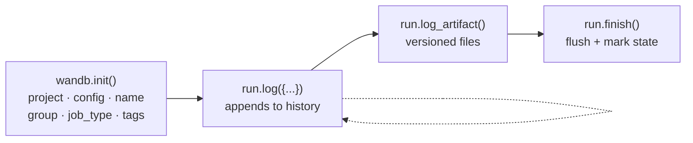

# Weights & Biases: experiment tracking that stays trustworthy

Read this when instrumenting anything with a training loop, or when W&B runs exist but
turn out to be unusable later. Verified against **wandb 0.31.0** (2026-10-16) on Python
3.13 and 3.14, with 0.28.2 for comparison: signatures were introspected from the installed
package and behavior notes executed in offline mode. Anything surprising is reproduced in
`verified-behavior.md`.

Contents: [What W&B is for](#what-wb-is-for) · [Setup and auth](#setup-and-auth) ·
[The run lifecycle](#the-run-lifecycle) · [Config](#config) · [Logging metrics](#logging-metrics) ·
[Summary](#summary) · [Media, tables, and models](#media-tables-and-models) ·
[Artifacts](#artifacts) · [Offline and resumed runs](#offline-and-resumed-runs) ·
[Distributed and multi-process runs](#distributed-and-multi-process-runs) ·
[Sweeps](#sweeps) · [Reading runs back](#reading-runs-back) ·
[Where W&B is the wrong tool](#where-wb-is-the-wrong-tool) · [Naming conventions](#naming-conventions)

## What W&B is for

A hosted store for the `(inputs, outputs, artifacts)` of a run, with a UI for comparing
runs. It answers "which configuration produced this curve, and where are the weights",
which is the question a log file answers badly and a directory of TensorBoard event files
answers not at all.

It is not a logging system. Events, errors, and tracebacks stay in stdlib logging;
`references/rules.md` has the division of labor. W&B does capture your process's
stdout/stderr into the run (`settings.console` defaults to `"wrap"`), so console log
records show up on the run page as a side effect. That is convenient, and no substitute
for a real log stream.

## Setup and auth

```bash
pip install wandb
wandb login                # writes the key to ~/.netrc
export WANDB_API_KEY=...   # CI; never in source (rule WB005)
```

Since 0.31.0 the default server is CoreWeave Forge (`https://api.forge.coreweave.com`, run
links under `https://forge.coreweave.com/wandb`), so a fresh `wandb login` writes
`machine api.forge.coreweave.com` to `~/.netrc`. Keys stored for `api.wandb.ai` keep
working. To ask "is a key configured?" without prompting, use `wandb.login(prompt=False,
verify=False)` (0.30.0+), which returns a bool, rather than reading `~/.netrc` yourself.

Environment variables map 1:1 onto `wandb.init` parameters: `WANDB_PROJECT`,
`WANDB_ENTITY`, `WANDB_NAME`, `WANDB_TAGS`, `WANDB_MODE`, `WANDB_DIR`, `WANDB_RUN_ID`.
This is how you drive a run from a job script without touching the code, and how
integrations (HF `Trainer(report_to="wandb")`, Lightning's `WandbLogger`) get configured.

`WANDB_MODE` values, from the SDK's own `wandb.init` docstring:

| Mode | Behavior |
|---|---|
| `online` | Default. Live sync. |
| `offline` | Writes to `./wandb/offline-run-*`; sync later with `wandb sync <dir>`. Keep the folder. |
| `disabled` | Every run method becomes a no-op. This is what unit tests should use. |
| `shared` | Experimental: several processes on different machines log to one run. |

Without a key, `wandb.init()` in a script raises `UsageError` ("No API key configured")
rather than going offline, and with a key but no network it raises `CommError` after
`init_timeout` (90 s by default). `obslog.wandb_run.resolve_mode()` asks
`wandb.login(prompt=False)` whether a key exists and picks `offline` if not, and
`start_run()` retries offline on `CommError`, so neither case kills the job. A bad or revoked
key raises `AuthenticationError`, which subclasses `CommError`; `start_run()` re-raises it rather
than hiding it behind an offline run.

An outage that starts after `init` does not stop training: `run.log()` writes to the local
service, which retries the upload. It can stall the end of the job instead: `finish_timeout`
defaults to 0 on 0.31.0, which makes `run.finish()` (and the atexit teardown) block until every
byte is uploaded. Set `settings=wandb.Settings(finish_timeout=N)` or `WANDB_FINISH_TIMEOUT` when a
job must exit on time; past the limit the run is marked crashed and may miss data. The setting is
read from the environment (checked on 0.31.0), but one test against a local stub server with a
large upload backlog saw `finish()` keep waiting past it, so check the exit on your own setup.

## The run lifecycle

```python
import wandb

with wandb.init(project="lm-from-scratch", config=cfg, job_type="train") as run:
    run.log({"train/loss": loss, "train/step": step})
```



The context manager is the point (rule WB003): normal exit calls `finish()`, and an
exception leaving the block calls `finish(exit_code=1)`, so the run shows as **failed**.
Without it, an *uncaught* crash is still marked failed, because `wandb.init` installs its
own `sys.excepthook`. The case the context manager fixes is an exception that is caught
further up: a sweep agent's function, a retry loop, a train-then-eval script, a notebook
cell. There the process keeps going, the run stays open, and it is eventually recorded as
**finished** with exit code 0 (verified: `verified-behavior.md` section 11). A `SIGKILL`
or OOM kill is handled by neither; the server marks that run **crashed** once its
heartbeats stop. In a notebook, prefer the `with` block per cell; if you hold a run
across cells, call `run.finish()` yourself.

`obslog.wandb_run.start_run()` wraps this: offline fallback, `define_metric` setup, the
run id bound into the logging context, and a `logger.exception` on the way out so the
training log and the dashboard tell the same story.

Identity parameters, and what each is actually for:

| Parameter | Use |
|---|---|
| `project` | Required in practice (WB001). The unit of access control and of the runs API. |
| `entity` | User or team owning the project. Omit for your default. |
| `name` | Human-readable run name. Omit and W&B generates one (`smart-capybara-42`). A name encoding the varied parameters (`lr3e-4-bs32-seed1`) makes a run list readable at a glance. |
| `id` | Stable run id, needed for resuming. Unique within the project; cannot be reused after the run is deleted. |
| `group` | Runs that belong together: the ranks of one DDP job, the seeds of one experiment. The UI aggregates by group. |
| `job_type` | `train` / `eval` / `preprocess`. Distinguishes roles within a group. |
| `tags` | Free-form labels you can filter on later (`baseline`, `ablation`, `paper-v2`). |
| `notes` | A sentence about what you were testing. The field you will wish you had filled in. |
| `save_code` | Saves the main script to the run so the code and the numbers stay together. Off by default. |
| `reinit` | What a second `wandb.init()` does while a run is open. The default in a script returns the **open run** and ignores the new arguments (config included); `"finish_previous"` closes it first; `"create_new"` makes an independent run but leaves `wandb.run` pointing at the old one. |

## Config

```python
with wandb.init(project="lm", config=asdict(cfg)) as run:
    ...
run.config["lr"]                                  # read
run.config.update({"lr": 2e-4}, allow_val_change=True)   # deliberate change
```

Pass the whole config object, not a subset (rule WB002). Values are immutable after
`init`: assigning a different value to an existing key (or `config.update` without the
flag) raises, with the message naming both values. Adding a new key is allowed.

```
ConfigError: Attempted to change value of key "lr" from 0.001 to 0.002
If you really want to do this, pass allow_val_change=True to config.update()
```

That immutability is a feature: a config that mutates mid-run no longer describes the
run. `allow_val_change=True` is for values genuinely resolved later (an `auto` batch size,
a computed vocabulary size). In notebooks `allow_val_change` defaults to True, so the
guard is off there; values that change during training (a learning rate under a
schedule) belong in `run.log`, not config.

Secrets must not go in (rule LOG008): a run config is readable by everyone with project
access and is returned by the public API. `obslog.wandb_run.redact_config` strips
secret-looking keys if a config dict is assembled from the environment.

## Logging metrics

```python
run.log({"train/loss": loss, "train/lr": lr, "train/step": global_step})
```

Rules that keep the history usable:

**Log your counter instead of passing `step=`** (rule WB006). W&B's internal step is
monotonic; a lower step is discarded with no exception and `run.step` does not move
(0.31.0 prints a terminal warning; 0.27 to 0.30 printed nothing offline). Instead, log
your counter as a metric and declare it as the x-axis once, at init:

```python
run.define_metric("train/step")
run.define_metric("train/*", step_metric="train/step")
run.define_metric("epoch")
run.define_metric("val/*", step_metric="epoch")
```

Now `train/*` plots against optimizer steps and `val/*` against epochs, on the same run,
without either counter interfering with the other.

**One `log` call per logical step.** Each call to `run.log` without `commit=False` closes
the current step. Splitting one step across several calls creates several steps with
mostly-missing values. To accumulate:

```python
run.log({"train/loss": loss}, commit=False)
run.log({"train/grad_norm": gn})          # commits both as one step
```

**Namespace with `/`.** `train/loss`, `val/loss`, `system/gpu_mem` group into panels in
the UI. Flat names produce one long ungrouped list.

**Log at a frequency a human can read.** Per-step for cheap scalars is fine; images,
tables, and histograms every step will make the run page slow to load and the sync
expensive. Every N steps, or once per epoch.

**Log the numbers you will actually compare**: loss, the evaluation metric, learning rate,
gradient norm, throughput (tokens/s or samples/s), and time per step. Learning rate and
grad norm are the two people skip and then wish they had when a run diverges.

## Summary

`run.summary` holds one value per key: the run's headline number, and the column the
runs table sorts by. By default it is the *last* logged value, which for a noisy metric is
not the best one.

```python
run.summary["best_val_loss"] = best          # explicit, and clearest
run.define_metric("val/loss", summary="min") # or let W&B track it
```

Verified gotcha: `define_metric(..., summary="min")` changes the *shape* of the summary
value. `run.summary["val/loss"]` is then a `SummarySubDict` (`{'min': 0.2}`), not a float,
so code that compares it numerically raises `TypeError`. Setting your own explicit key
sidesteps this. Accepted `summary` values in 0.31.0: `"min"`, `"max"`, `"mean"`,
`"last"`, `"first"`, `"none"` (`"best"` and the `goal=` argument were removed in 0.29.0).

## Media, tables, and models

- `run.log({"samples": wandb.Image(array_or_path, caption="epoch 3")})`: images; masks
  and bounding boxes are supported through `wandb.Image(..., masks=...)`. Since 0.29.0
  `wandb.Image` no longer rescales pixel values: a float array in [0, 1] must be
  multiplied by 255 (and cast to `uint8`) first, or it is saved as a black image
  (verified: a constant 0.8 array saved as pixel value 0 on 0.31.0, 204 on 0.28.2).
- `wandb.Table(columns=[...])` + `table.add_data(...)`: a table of predictions, which can
  contain `wandb.Image` cells. Log per evaluation, not per step.
- `run.watch(model, log="gradients", log_freq=1000)`: PyTorch only; hooks the module and
  logs gradient (or parameter) histograms every `log_freq` steps. Useful when diagnosing
  vanishing/exploding gradients, expensive to leave on for a long run.
- `run.alert(title=..., text=..., level=...)`: pushes a notification (email/Slack) from
  inside the run; the honest use is "loss went NaN", not routine progress.

## Artifacts

An artifact is a versioned file or directory bound to the run that produced it. Prefer it
over `run.save(path)`, which just copies bytes into the run's file list with no version, no
metadata, and no lineage.

```python
art = wandb.Artifact(name="model-weights", type="model",
                     metadata={"epoch": 3, "val_loss": 0.21})
art.add_file("ckpt.pt")            # or art.add_dir("checkpoints/")
run.log_artifact(art, aliases=["best"])
```

Consuming one, in a later run, records the dependency so the lineage graph is complete:

```python
artifact = run.use_artifact("entity/project/model-weights:best")
local_dir = artifact.download()
```

Versions are `v0, v1, ...`; aliases (`latest`, `best`, `prod`) are movable pointers. Fetch
by alias in code so the pipeline follows the pointer instead of a hardcoded version.

Verified gotcha: reading `artifact.aliases` or `.version` on the object returned by
`log_artifact` raises `ArtifactNotLoggedError` until the upload finishes. Call
`artifact.wait()` first, and expect it to stay unavailable in offline mode.

Type conventions worth keeping: `dataset`, `model`, `eval-results`. The type is what
groups artifacts in the UI and what `api.artifact(..., type=...)` filters on.

## Offline and resumed runs

**Offline**: `WANDB_MODE=offline` writes everything under `./wandb/offline-run-*`; upload
later with `wandb sync wandb/offline-run-20260826_221938-oub2alu6`. This is the mode for
air-gapped clusters and for a laptop on a plane. Two consequences to plan for: `run.url` is
`None` (guard before formatting it into a log line), and artifact metadata that requires a
server round trip is unavailable.

**Resuming** a preempted job means reusing the run id:

```python
run = wandb.init(project="lm", id=stable_id, resume="allow", config=cfg)
if run.resumed:                    # online only; False in an offline process
    start_step = run.step          # continue the history rather than restarting it
```

`resume` values: `"allow"` (resume if the id exists, else create), `"must"` (fail if it
does not exist), `"never"` (fail if it does), `"auto"` (resume from local run state after a
crash on the same machine). Generate the id yourself from something stable (a job id, or
`uuid.uuid4().hex[:8]` written next to the checkpoint) so a restarted job finds it.
`wandb.util.generate_id()` does not exist in 0.28.2 or 0.31.0 (`AttributeError`).

Verified: resume does **not** work inside an offline process. Offline `init` with an
existing id and `resume="allow"` (or `"must"`) keeps the id but returns
`run.resumed == False` and `run.step == 0`, because the history lives on the server.
0.31.0 made `resume="must"` work for offline runs at *sync* time (`wandb sync` appends to
the existing run, and fails if there is none), so the uploaded history can be continuous,
but the training process still has to take its resume point from the checkpoint.

## Distributed and multi-process runs

Two supported shapes:

1. **One run, rank 0 logs** (simplest). Only rank 0 calls `wandb.init` and `run.log`;
   other ranks all-reduce their metrics to rank 0 first. Everything lands on one run,
   which is what you want for loss curves.
2. **One run per rank, grouped**: every rank calls `init(group=job_id, job_type=f"rank-{rank}")`.
   The UI aggregates the group. Use when per-rank behavior (a stalling rank, imbalanced
   memory) is what you are debugging.

Keep each run object in the process that created it. Passing `step=` from several
processes is where the SDK itself warns about data loss ("setting step in
multiprocessing can result in data loss"). The experimental `mode="shared"` exists for
the primary/worker case if you truly need one run across machines.

## Sweeps

A sweep is a search space plus an agent that starts one run per configuration.

```python
sweep_config = {
    "method": "bayes",                       # grid | random | bayes
    "metric": {"name": "val/loss", "goal": "minimize"},
    "parameters": {
        "lr":         {"distribution": "log_uniform_values", "min": 1e-5, "max": 1e-2},
        "batch_size": {"values": [16, 32, 64]},
        "dropout":    {"min": 0.0, "max": 0.5},
    },
    "early_terminate": {"type": "hyperband", "min_iter": 3},
}
sweep_id = wandb.sweep(sweep_config, project="lm-from-scratch")
wandb.agent(sweep_id, function=train_one, count=20)
```

The training function called by the agent reads its hyperparameters from the run's config,
because the agent is what sets them:

```python
def train_one():
    with wandb.init() as run:        # config is injected by the agent
        cfg = run.config
        ...
        run.log({"val/loss": val_loss})   # the metric named in the sweep config
```

Points that decide whether a sweep is useful:

- The `metric.name` must match a key you actually log, exactly. A typo yields a sweep that
  optimizes nothing and reports no error.
- `bayes` needs enough completed runs to model the space; with only a handful it is little
  better than `random` (a rule of thumb, not a documented threshold).
- `early_terminate` with hyperband kills unpromising runs early. Brackets count how many
  times the target metric has been logged, not the value of any step counter, so log it
  at a consistent cadence.
- A parameter given only `min`/`max` floats defaults to `uniform` (ints to `int_uniform`).
- `wandb agent --max-consecutive-failed-runs N` (0.31.0) stops an agent after N failures
  in a row, and `wandb sweep-scheduler` runs the search locally with Optuna or Ax.
- Agents can run on several machines against the same `sweep_id`; that is the parallelism
  mechanism.
- Coming from Optuna: the search space dict replaces the `suggest_*` calls, the agent
  replaces `study.optimize`, and pruning (`early_terminate`) replaces the pruner. Optuna's
  advantage is programmatic control of the search; W&B's is that every trial is a full run
  with artifacts and a shared dashboard.

## Reading runs back

Everything logged is queryable through the public API, which is how a sweep turns into a
table or a paper figure:

```python
import wandb
api = wandb.Api()
runs = api.runs("entity/project",
                filters={"state": "finished", "config.model": "transformer"},
                order="+summary_metrics.val/loss")

for run in runs[:10]:                      # always slice; a project can be huge
    print(run.name, run.config["lr"], run.summary.get("val/loss"))

best = runs[0]
for artifact in best.logged_artifacts():
    if artifact.type == "model":
        artifact.download(root="./best_model")
```

Filters use MongoDB-style operators (`{"summary_metrics.accuracy": {"$gt": 0.9}}`,
`$and`, `$lt`, date ranges on `created_at`). `run.history()` returns a sampled time series
and `run.scan_history()` the full one, when the summary is not enough. For a local run
that has not been synced, `wandb leet inspect --summary <wandb dir>` (0.31.0) prints its
state, last metric values and config.

## Where W&B is the wrong tool

- **Application logs.** Events, errors, tracebacks -> stdlib logging.
- **Production service metrics.** Request rates and latency percentiles belong in a metrics
  system (Prometheus/OTel), not in run history.
- **Large data.** Artifacts version files; they are not a data lake. Reference-type
  artifacts point at S3/GCS instead of copying.
- **Anything private that cannot leave the machine.** Offline mode still writes to disk in
  a syncable form; if the constraint is "must never be uploadable", use TensorBoard or
  files.
- **A one-file experiment you will delete tomorrow.** The overhead is small but not zero.

## Naming conventions

Conventions that make a project's runs readable a year later, none of which W&B enforces:

- Metrics: `split/metric`, such as `train/loss`, `val/loss`, `test/acc`, `system/gpu_mem`.
- Counters as metrics: `train/step`, `epoch`, declared with `define_metric` as x-axes.
- Runs: encode what varies (`lr3e-4-bs32-seed1`) and leave the rest to config.
- Groups: one per experiment (`ablation-rope`), one job type per role (`train`, `eval`).
- Artifacts: `model-weights`, `tokenizer`, `eval-set`; aliases `best` and `prod` moved
  deliberately, `latest` left to W&B.
- Tags: the axis you will filter on later (`baseline`, `ablation`, `debug`). Anything
  tagged `debug` can then be excluded from every comparison in one click.
